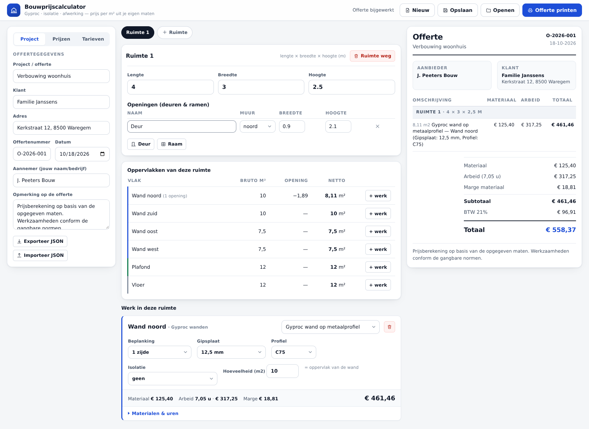
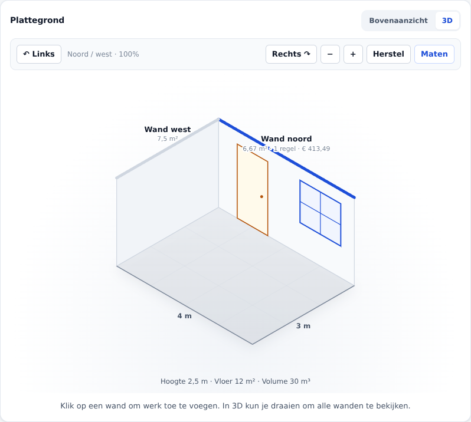

# 🏗️ Bouwprijscalculator

**Prijzen berekenen voor bouwwerk op basis van maten — gestart met Gyproc.**



> 🌐 **Direct openen (geverifieerd werkend):**
> <https://htmlpreview.github.io/?https://github.com/guypeers2-cmyk/guypeers2-gmail.com/blob/v2.1.0/bouwcalculator/bouwcalculator.html>
>
> 🏗️ **Zelf hosten (de beste optie):**
> **https://patient-sun-c959.guypeers2.workers.dev** — Cloudflare Worker · één commando:
> `bash bouwcalculator/deploy/nu-publiceren.sh` (vanuit de repo-map!)
> of GitHub Pages (één klik): <https://guypeers2-cmyk.github.io/guypeers2-gmail.com/>
>
> ⬇️ Release: <https://github.com/guypeers2-cmyk/guypeers2-gmail.com/releases/tag/v2.1.0>

Een zelfstandige webapp (zonder dependencies, pure Python-stdlib) waarmee een
bouwer of werknemer vanuit de maten van een ruimte een offerte opstelt:
oppervlakken → materiaalname (take-off) → gewerkte uren → prijs → BTW.

De app draait volledig offline. Er gaat niets naar een externe dienst.

---

## Snel starten

```bash
python3 bouwcalculator/server.py          # → http://localhost:8090
PORT=9000 python3 bouwcalculator/server.py
```

Of: open **`bouwcalculator/web/bouwcalculator-standalone.html`** — de app in één
bestand (CSS, prijsboek, rekenkern en app allemaal erin). Geen server, geen
internet, geen installatie: ideaal om mee naar de werf te nemen of op een
telefoon te openen. Opnieuw genereren:

```bash
python3 bouwcalculator/tools/maak_standalone.py
```

Tests:

```bash
python3 -m unittest discover -s bouwcalculator/tests -v   # 19 tests
```

---

## Deployen naar Cloudflare Workers

De app draait op drie manieren — alle drie zijn getest:

| Wijze | Wanneer | Hoe |
|-------|---------|-----|
| **Lokale server** | ontwikkelen, offline | `python3 bouwcalculator/server.py` |
| **Cloudflare Worker** | live op internet | `npx wrangler deploy` |
| **Statische hosting** | zonder API | de app rekent dan zelf in de browser |

### De Worker publiceren

**Eén commando** (deploy + controle in één keer):

```bash
bash bouwcalculator/deploy/nu-publiceren.sh
```

Het script gaat vanzelf naar de repo-map, zet het token klaar (of vraagt het
veilig op), doet `wrangler deploy` en controleert daarna of de URL echt onze
app serveert in plaats van de standaard "Hello World!".

Handmatig kan ook, **maar dan vanuit de map met `wrangler.toml`**:

```bash
cd <repo>                 # map met wrangler.toml
npx wrangler login        # één keer, inloggen bij Cloudflare
npx wrangler deploy
```

> ⚠️ **Let op:** `npx wrangler deploy` vanuit een *andere* map dan de repo
> vindt geen `wrangler.toml` en zet dan de standaard "Hello World!"-worker
> op. Draai het daarom altijd in de repo-map (of gebruik het script).

De worker heet `patient-sun-c959` (zie `wrangler.toml`) en komt live op:

**https://patient-sun-c959.guypeers2.workers.dev**

Controleren of er echt onze app staat (statische bestanden, API én een
voorbeeldberekening):

```bash
bash bouwcalculator/deploy/controle.sh
```

De Worker serveert de app (statische bestanden) en rekent `/api/*` met de
JS-rekenkern. De bestanden in `bouwcalculator/web/` worden automatisch
meegestuurd als assets.

### Deployen bij elke push (GitHub Actions)

De snelste route is het meegeleverde script — één commando doet alles:

```bash
git clone -b arena/c5fdb0b8-guypeers2-gmail-com \
  https://github.com/guypeers2-cmyk/guypeers2-gmail.com.git
cd guypeers2-gmail.com
bash bouwcalculator/deploy/ci.sh
```

Het script controleert je GitHub-login, vraagt om het Cloudflare-token (onzichtbaar
invoer) en zet het als versleuteld secret, plaatst de workflow en pusht.

Het token maak je zelf aan op
<https://dash.cloudflare.com/profile/api-tokens> met de rechten
*Edit Cloudflare Workers* (Account Resources → jouw account). Het token komt
nooit in de repo of in een log terecht.

De workflow draait eerst de tests (Python + JS-pariteit) en deployt daarna:

```
.bouwcalculator/deploy/deploy-worker.yml  →  .github/workflows/deploy-worker.yml
```

### GitHub Pages (publiceren zonder Cloudflare)

De app werkt ook zonder API: dan rekent de browser zelf (de rekenkern zit in
`web/engine.js`). Publiceren kan dus via GitHub Pages, zonder token:

**Settings → Pages → Build and deployment → Deploy from a branch**

| | |
|---|---|
| Branch | `arena/c5fdb0b8-guypeers2-gmail-com` |
| Folder | `/bouwcalculator/web` |

Het resultaat komt op `https://<github-user>.github.io/<repo>/`. Let op: daar
worden offertes in de browser bewaard (localStorage) in plaats van op de
server.

### Workers Builds (Cloudflare)

Is de repo in de Cloudflare-dashboard aan een Worker gekoppeld, dan volstaat
een push: de build doet `wrangler deploy` voor je. De branch-preview komt dan
op `patient-sun-<branch>.guypeers2.workers.dev`.

> De sandbox waarin dit gebouwd is kan `dash.cloudflare.com` en
> `api.cloudflare.com` niet bereiken (netwerkbeperking), dus de eerste
> publicatie moet vanaf een machine met vrij internet gebeuren.

### Twee rekenkernen, één waarheid

Op Workers draait JavaScript, lokaal draait Python. Daarom is de
rekenkern twee keer geschreven — en bewaakt een test dat ze identiek zijn:

```
bouwcalculator/tests/test_pariteit.py  →  17 projecten, cent voor cent gelijk
```

Het prijsboek wordt gegenereerd (`npm run prijsboek`), dus ook dat kan niet
uit elkaar lopen.

---

## De werkwijze in de praktijk

1. **Offertegegevens** — klant, adres, datum, offerte-nummer, je eigen naam.
2. **Ruimte** — lengte × breedte × hoogte, plus deuren en ramen per muur.
   De app rekent zelf de bruto, afgetrokken en netto oppervlak uit:

   | Vlak | Berekening |
   |------|-------------|
   | Wand noord / zuid | lengte × hoogte − openingen |
   | Wand oost / west | breedte × hoogte − openingen |
   | Plafond / vloer | lengte × breedte |

3. **Werk kiezen** — bij elk oppervlak op *+ werk*. Per werkregel stel je de
   opties in (1 of 2 zijden beplankt, welke plaat, welk profiel, isolatie of niet).
   Of klik gewoon **op de wand in de plattegrond**: de werkregel komt er dan
   automatisch bij.
4. **Offerte** — rechts staat het offertedocument: materiaal, arbeid, marge,
   korting, BTW en totaal. Met **🖨 Offerte printen** wordt het een A4-PDF
   (via de printknop van je browser).

---

## De plattegrond

De app tekent de ruimte voor je uit — in zuivere SVG, dus scherp op elke
printer en in elke browser:

* **Bovenaanzicht** — wanden met dikte, deuren met slag, ramen met kozijn,
  maatvoering (lengte, breedte, hoogte) en per wand het nettoppervlak plus
  het werk dat er al op staat.
* **3D** — een axonometrische doorsnede met vloerraster, raamkozijnen,
  glas, deuren met klink en uitsparingen op de opgegeven hoogte.
  Met **Links/Rechts** draai je in stappen van 90° langs alle vier de wanden.
  **+/−** zoomt tussen 75% en 160%; **Herstel** zet de camera terug.
  **Maten** schakelt de maatvoering en het overzicht van hoogte, vloeroppervlak
  en volume aan of uit. Klik op een 3D-wand om werk toe te voegen;
  een blauwe bovenrand geeft aan dat er al werk op staat.
  Dit is een schematische doorsnede, geen vrij draaibaar BIM-model.

Klik op een wand (of op een deur daarin) en de werkregel voor dat vlak wordt
toegevoegd. De plattegrond staat ook in het **gedrukte offerte-document**,
zodat de klant ziet over welke ruimte het gaat.



### Deuren en ramen plaatsen

Bij elke opening stel je **Vanaf start** en **Boven vloer** in (meter).
Noord/zuid meten vanaf de westhoek, oost/west vanaf de noordhoek.
Laat **Vanaf start** leeg voor automatische verdeling. **Boven vloer** is
bijvoorbeeld 0,90 m voor een raam met een vensterbank op die hoogte.
De positie en borstwering worden opgeslagen en mee geëxporteerd naar JSON.
De tekening begrenst openingen tot de wand; de calculatie gebruikt steeds
de ingevoerde breedte en hoogte. Dit is een schematische visualisatie,
geen uitvoeringsplan. De 3D-uitsnede toont steeds twee achterwanden; draai de camera om alle vier de wanden te bekijken.

De tekening wordt opnieuw opgebouwd zodra er iets verandert: maten, deuren,
ramen of werkregels. De module `web/plattegrond.js` staat helemaal los van
de rekenkern en gebruikt geen browser-API's die niet in een testomgeving
beschikbaar zijn.

---

## Elektriciteitswerken

Per ruimte staat nu een kaart **Elektriciteit**. Kies een wand, vloer of plafond,
klik een werkpakket aan en vul het **aantal** of de **lengte in meter** in.
Elk toegevoegd pakket begint met 1 stuk/meter; meet de werkelijke hoeveelheid.

| Werkpakket | Eenheid | Materiaal / eenheid (excl. btw) | Arbeidsnorm |
|---|---|---:|---:|
| Stopcontact enkel, inbouw | st | € 12,50 | 0,35 u/st |
| Stopcontact dubbel, inbouw | st | € 23,00 | 0,50 u/st |
| Schakelaar enkelpolig, inbouw | st | € 11,00 | 0,30 u/st |
| Lichtpunt aansluiten | st | € 3,50 | 0,25 u/st |
| Kabel XVB 3G2,5 aanbrengen | m | € 1,65 | 0,06 u/m |
| Kabel XVB 3G1,5 aanbrengen | m | € 1,20 | 0,06 u/m |
| Sleuf frezen in metselwerk | m | € 0,00 | 0,18 u/m |
| Sleuf dichtzetten | m | € 0,85 | 0,10 u/m |

**Dit zijn indicatieve, gekozen startwaarden, geen geverifieerde marktprijzen.**
Pas ze aan in de hoofdtab **Tarieven**, categorie **Elektriciteit**.
Arbeid = hoeveelheid × arbeidsnorm × projectuurtarief. De bestaande materiaal-
marge, korting en btw gelden ook voor deze posten. Bedragen tonen twee decimalen.

- Een enkel/dubbel stopcontact of schakelaar bevat het mechanisme, standaard
  afdekking en inbouwdoos/dozen; geen aparte kabellengte of sleuf.
- Een dubbel stopcontact telt als één dubbel punt (niet als twee enkele).
- Lichtpunten bevatten aansluitmateriaal, geen armatuur.
- Kabels bevatten geen buis, sleuf of aansluitpunt. De kabelkeuze is een
  handmatige raming, geen automatisch advies over kabelsecties.
- Frezen geldt indicatief voor een sleuf tot 3 × 3 cm in baksteen; zonder
  inbouwdoosgat, afvoer, kabel of dichtzetten. Niet voor beton of dragende delen.
- Dichtzetten bevat vulmateriaal; schilderwerk en eindplamuur apart begroten.
- Stopcontacten/schakelaars/lichtpunten worden naar hele stuks naar boven
  afgerond; lengtes mogen decimalen hebben. Ontbrekende hoeveelheid = 0,
  nooit het wandoppervlak. Negatieve hoeveelheden worden 0.
- De snelle m²-modus heeft **geen invloed** op elektriciteitsregels.
- Opslaan, JSON export/import, tarievenherstel en print werken voor alle posten.

**Zonder verdeelkast, keuring, schema’s of AREI-conformiteitscontrole.** Dit is
geen installatieontwerp; laat ontwerp en uitvoering door een vakbekwaam
elektricien beoordelen. Op de offerte staat hiervoor een waarschuwing.
Er worden geen fictieve stopcontactposities in 3D geplaatst: de locatie is
voorlopig een gekozen wand/vloer/plafond, niet een exact installatiepunt.

---

## De rekenkern in het kort

Per werkpakket rekent de app twee dingen uit:

**Materiaal (take-off)** — hoeveel is er nodig?

- gipsplaten: oppervlak × 1,10 verspilling → aantal platen van 3,12 m²
- C-profiel: spoorafstand 40 cm + 1 stuk per wand + 2 stuks per opening
- U-profiel en vlakke band: omtrek van de wand
- veerhangers (plafond): per profiel om de 80 cm
- schroeven: 20 per m² · voegband: 1,4 m per m² · voegmiddel: 0,5 kg per m²
- isolatie: wandoppervlak + 5%

**Arbeid (uren)** — hoe lang duurt het?

| Taak | Uren/m² |
|------|---------|
| Wand opmeten en uitsetten | 0,05 |
| Profielen plaatsen | 0,30 |
| Isolatie plaatsen | 0,10 |
| Platen bevestigen | 0,22 |
| Voegen en afwerken | 0,30 |

Uren × uurtarief (standaard €45/u) = arbeidskosten. Daar bovenop komt een
marge op het materiaal (standaard 15%).

De normen staan als常量en bovenaan `bouw/bereken.py` — één vakman past ze
in één oogopslag aan.

---

## Twee prijsmodi

| Modus | Wat je ziet |
|-------|-------------|
| **Detailschuif** (standaard) | Volledige namenlijst van materiaal en de uren per taak |
| **Snelle m²-prijs** | Eén prijs per m² — snel op de werf, geen namenlijst |

De m²-prijzen worden **afgeleid uit de detailschuif** (referentie: een wand van
4,0 × 2,5 m met één deur). Ze kloppen dus altijd met de gedetailleerde
berekening, en je kan ze per project aanpassen.

---

## Tarieven aanpassen

Het prijsboek staat in de **eigen hoofdtab Tarieven**, naast **Calculator & offerte**.
Materiaalprijzen en snelle m²-prijzen worden met precies twee decimalen getoond,
evenals het uurtarief en alle bedragen in de offerte, details en 3D-weergave.
Na het bewerken van een geldveld wordt bijvoorbeeld `7.5` weergegeven als `7.50`.
Uurnormen zijn geen eurobedragen en behouden hun eigen precisie.

Zoek op de naam van een tarief of filter op **Materiaal**, **Uurnormen** en
**Snelle m²-prijzen**. **Alleen aangepast** toont uitsluitend tarieven waarvoor
je in deze offerte een eigen waarde hebt ingevuld. De teller vermeldt hoeveel
tarieven zichtbaar en aangepast zijn. De markering **Eigen tarief** betekent
ook bij een gelijk bedrag dat er een expliciete projectwaarde is opgeslagen.

Met **Herstel** naast een tarief verwijder je die eigen waarde. Met
**Alle tarieven herstellen** verwijder je na bevestiging alle eigen tarieven
van deze offerte. De calculatie gebruikt daarna weer de standaardprijzen;
snelle m²-prijzen worden opnieuw afgeleid uit de geldende materiaal- en
uurnormen. Het uurtarief, kortingen, btw en werkregels blijven ongewijzigd.


Onder het tabblad **Tarieven** staan alle eenheidsprijzen, alle uren per m²
en alle snelle m²-prijzen. Wat je daar verandert, wordt meteen doorberekend
en mee opgeslagen met de offerte. De standaardtarieven staan in
`bouw/tarieven.py` en zijn een marktreferentie voor België — pas ze aan op
jouw inkoop.

---

## Een werkpakket toevoegen

Een werkpakket bestaat uit twee stukken:

1. **Metadata** in `bouw/tarieven.py` (`PAKKETTEN`): naam, categorie, eenheid
   en de opties met hun standaardwaarden.
2. **Een berekening** in `bouw/bereken.py`: een functie die een `Ctx`
   krijgt en `(materiaalregels, taken)` teruggeeft. Registreer hem in
   `BEREKENERS` en de calculator kent hem meteen.

De m²-snelprijs wordt automatisch uit de nieuwe berekening afgeleid.

---

## Bestandsstructuur

```
bouwcalculator/
├── server.py            # webserver (statische bestanden + JSON-API)
├── bouw/
│   ├── model.py         # Project, Ruimte, Opening, Werkregel (JSON-in/uit)
│   ├── tarieven.py      # prijsboek + werkpakketten (pure data)
│   ├── bereken.py       # de rekenkern: oppervlakken, namen, uren
│   ├── offerte.py       # project → berekende offerte met totalen
│   └── opslag.py        # offertes opslaan (data/projecten/*.json)
├── web/
│   ├── index.html       # de app
│   ├── styles.css       # stijl + print-opmaak voor de offerte
│   ├── app.js           # presentatielaag (alleen weergave)
│   ├── plattegrond.js   # 2D-bovenaanzicht en 3D-weergave (SVG)
│   ├── engine.js        # JS-rekenkern (Worker + browser-fallback)
│   └── prijsboek.js     # gegenereerd uit bouw/tarieven.py
├── worker/
│   ├── src/worker.js    # Cloudflare Worker: assets + /api/*
│   └── test/runner.mjs  # runner voor de pariteitstest
├── tools/
│   └── maak_prijsboek.py  # prijsboek genereren voor de JS-kern
├── deploy/
│   └── deploy-worker.yml  # GitHub Actions-workflow (kopiëren naar .github/workflows/)
├── tests/               # 19 unittest-tests
└── data/                # opgeslagen offertes (in .gitignore)
```

### API

| Route | Doet |
|-------|------|
| `GET /api/prijsboek` | tarieven, werkpakketten, referentieprijzen |
| `POST /api/offerte` | `{"project": {...}}` → de volledig berekende offerte |
| `GET /api/projecten` | opgeslagen offertes |
| `POST /api/projecten/opslaan` | offerte bewaren |
| `GET /api/projecten/<id>` | offerte teruglezen |
| `POST /api/projecten/verwijder` | offerte wissen |

---

## Uitbreiden

- **Meer ambachten**: spuiten, chape, isolatie, elektrisch — elk één werkpakket.
- **Per klant eigen tarieven**: de tarieven zitten in de offerte, dus een
  klant met eigen prijzen is een eigen project.
- **Meerdere verdiepen**: ruimtes zijn vrij in te delen — één ruimte per kamer.
- **Offerte als PDF**: de printopmaak staat in `web/styles.css`; via de
  printknop van de browser ("Als PDF opslaan") krijg je een A4-document.

---

## Hosting: wat werkt waarom

Niet elke host serveert HTML en JavaScript met het juiste MIME-type, en dat
bepaalt of de app opent:

| Host | `.html` | `.js` | App werkt? |
|------|---------|-------|-----------|
| Cloudflare Worker (onze eigen deploy) | `text/html` | `text/javascript` | ✅ |
| GitHub Pages | `text/html` | `text/javascript` | ✅ |
| onze Python-server | `text/html` | `application/javascript` | ✅ |
| jsDelivr / raw.githubusercontent (GitHub-bestanden) | `text/plain` | `text/plain` | ❌ alleen downloaden |
| lokaal bestand (`file://`) | — | — | ✅ (browser-engine) |

Daarom zijn er twee varianten:

- **meerbestanden** (`bouwcalculator/web/`) — voor onze eigen Worker, Pages en
  de lokale server. De rekenkern is een ES-module.
- **één bestand** (`bouwcalculator/bouwcalculator.html`, 86 KiB) — alles inline,
  dus het werkt ook op hosts die HTML als `text/plain` teruggeven of op een
  stickie/schijf. De app rekent dan in de browser.

`bouwcalculator/tools/maak_standalone.py` bouwt de één-bestand-variant uit de
brondbestanden; de Python-tests bewaken dat beide rekenkernels identiek
uitkomen (`tests/test_pariteit.py`).
