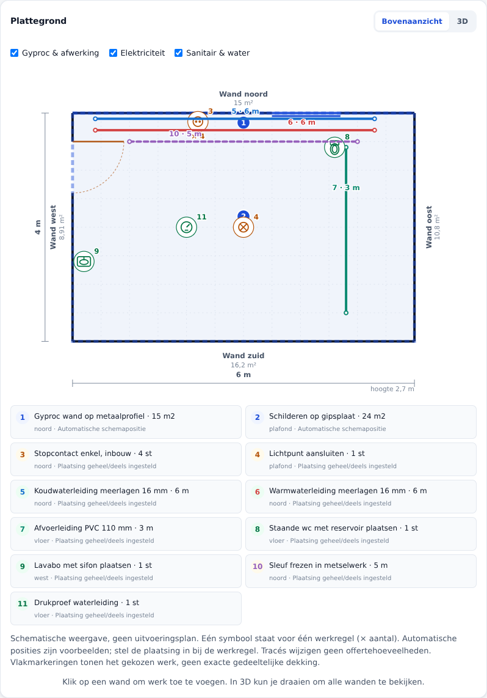
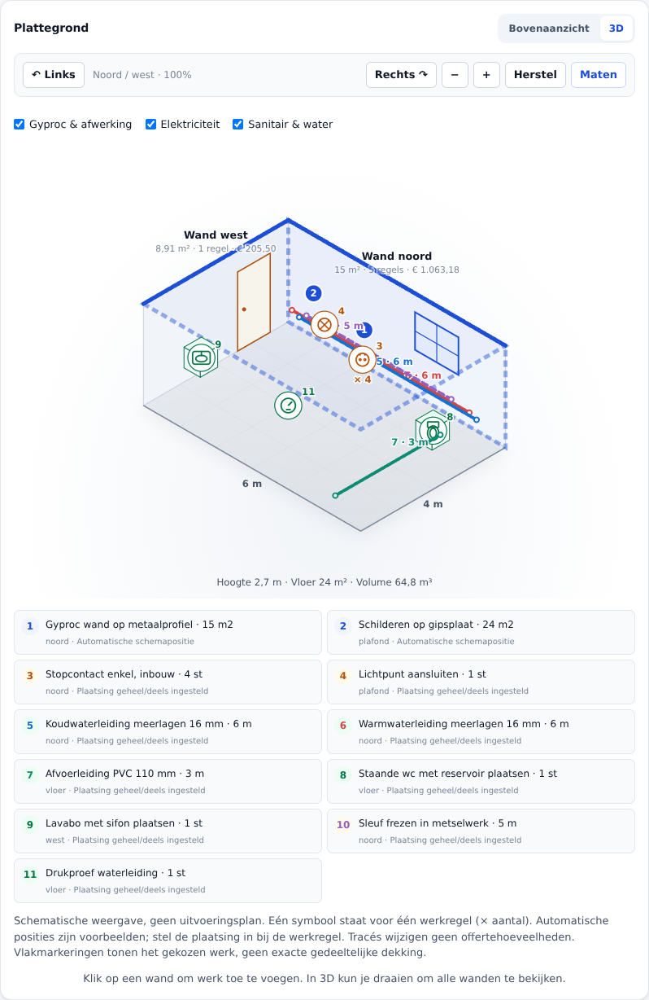

# Alle werken in 2D en 3D

## Wat staat op het plan?

De meetstaat van de gekozen ruimte is de bron. Elke positieve werkregel krijgt
een nummer; nulhoeveelheden worden niet als geplaatst werk getekend. Ruimteknoppen
wisselen tussen de plannen van kamers. Er is nog geen samengevoegde woningplattegrond.

- Afwerking/Gyproc: genummerde vlakmarkeringen, inclusief vloer en plafond.
  In 3D zijn de twee achterwanden zichtbaar; draai de camera voor de andere wanden.
- Elektriciteit: symbolen voor stopcontacten, schakelaars en lichtpunten;
  lijnen voor kabels en sleuven. Een dubbel stopcontact is één dubbel punt.
- Sanitair: symbolen voor alle toestellen/hulpstukken en de drukproef.
  Wc, lavabo, collector en wasmachinepunt hebben bovendien indicatieve 3D-volumes.
- Tracés: koud water blauw, warm water rood, afvoer groen, elektriciteit oker,
  sleuven paars en gestreept. Overige sanitaire meterposten groen.
- Eén symbool per werkregel, niet één per fysiek onderdeel. `× 4` betekent
  bijvoorbeeld vier stopcontacten op dezelfde schematische regel. Splits de
  regel in vier regels als je vier afzonderlijke plaatsingen wilt vastleggen.





## Plaatsing invoeren

Open bij een installatiepost **Plaatsing in 2D & 3D**.

| Veld | Betekenis |
|---|---|
| Start X | Afstand vanaf de westzijde, meter |
| Start Y | Afstand vanaf de noordzijde, meter |
| Hoogte Z | Afstand boven de vloer, meter |
| Eind X/Y/Z | Eindpunt van een meterpost, meter |

Leeg = automatische schematische voorbeeldplaatsing. Een deels ingevulde
plaatsing gebruikt voor de overige velden nog automatische waarden.
Coördinaten buiten de ruimte worden alleen voor de weergave begrensd, niet
in het project overschreven. Negatieve plaatsingscoördinaten worden bij invoer
naar nul genormaliseerd. Wijzigingen blijven behouden bij herladen, opslaan en
JSON export/import; ook beide rekenkernen bewaren de plaatsingsmetadata.

Klik een symbool, tracé of genummerde legendaregel om de betreffende werkregel
te selecteren. Toetsenbord: Tab naar een SVG-symbool, Enter of spatie om de
regel te openen/selecteren. De bestaande wandklik blijft Gyproc-werk toevoegen.
Er is geen slepen van objecten: posities stel je in met de metrische velden.

## Lagen en print

De drie laagkeuzes verbergen of tonen afwerking, elektriciteit en sanitair.
Dit is uitsluitend een weergavefilter: verborgen werken blijven in de offerte.
Op papier staan alle actieve werken met hun genummerde legenda. De hoofdkaart
kan in 3D draaien/zoomen zoals voorheen; print gebruikt het 2D-bovenaanzicht.

## Belangrijke beperkingen

- Geen uitvoeringsplan, elektrisch schema, hydraulisch ontwerp of conformiteitscontrole.
- Automatische posities zijn voorbeelden, geen voorgestelde veilige montagepunten.
- Tracés zijn rechte schematische lijnstukken. Bochten, doorvoeren en fysieke
  leidinglengtes worden niet afgeleid. De offerte gebruikt je gemeten hoeveelheid.
- Plafonds/floeren hebben in bovenaanzicht dezelfde contour; hun badges en
  legendaregels onderscheiden ze. Z-hoogtes veranderen het bovenaanzicht niet.
- Vlakmarkeringen tonen op welk vlak werk zit, geen exacte gedeeltelijke dekking.
- Sanitaire volumes zijn illustratief: geen echte productmaten of botsingscontrole.
- Meerdere elementen kunnen in projectie overlappen. Gebruik de lagen, draai de
  camera of pas posities aan; er is geen automatische collision-/clash-detectie.

## Testen

- Unit-test: alle 28 werkpakketten renderen in beide aanzichten; laagfilters,
  nulhoeveelheden, escaping en begrenzing gecontroleerd.
- Python/JS-pariteit vergelijkt ook de projectecho inclusief plaatsingsmetadata.
- 11-regelige gemengde voorbeeldscène: 2D/3D, indicatieve volumes, laagfilters,
  toetsenbordselectie, coördinaatwijziging, herladen, mobiele breedte en print.
- Plaatsingswijzigingen en laagfilters veranderen de offertotalen niet.

Herhaalbare optionele browsertest (dezelfde dependencies als de apparaatreview):

```bash
PORT=8094 python3 bouwcalculator/server.py
# tweede terminal
BROWSER_MODULE_ROOT=/tmp/bouw-browser APP_URL=http://localhost:8094/ \
node bouwcalculator/tools/visual_review.mjs
```

Resultaten: `/tmp/bouw-visual-review` (of `REVIEW_OUTPUT`). Met `APP_URL` test je
ook een lokale Worker of het standalone `file:///.../bouwcalculator.html`-bestand.
